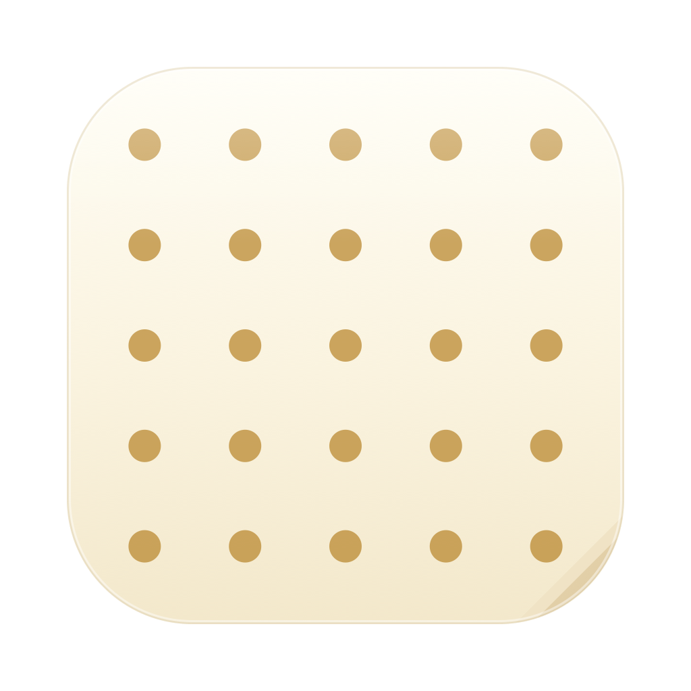
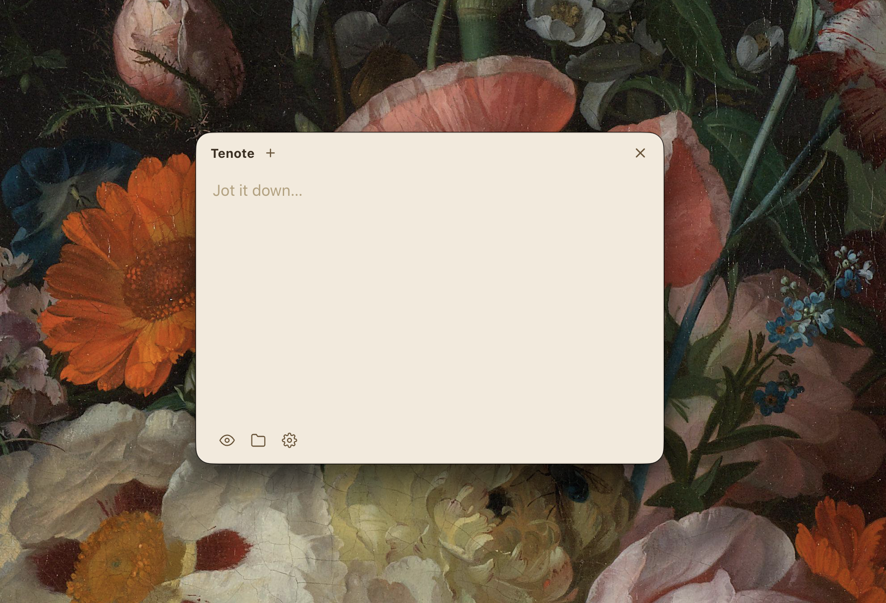

# Tenote

<p align="center">
  
</p>

The simplest notes app for Mac. Press **⌥.** (Option+Period) anywhere on your
screen. A small card floats up, you type, it saves itself. That's the whole app.

**100% free. Open source. Your notes are plain text files you own forever.**



> **Tenote 2.0 is the native Swift app.** The Electron build is frozen at 1.3.x:
> it still runs and the code stays in the repo, but it gets no new features. New
> installs should use **Tenote Native** below.

## Why "Tenote"?

The first working version was built for about **ten cents** of AI tokens. It felt
right for an app that proves good software can cost almost nothing to make, so it
costs you nothing to use. Free forever, MIT licensed.

*(iPhone app: coming soon.)*

## What it does

- One hotkey (**⌥.**) opens and closes it, from inside any app
- Every open is a fresh note. Whatever you were writing is already saved
- Notes save as **Markdown files** in `~/Documents/Tenote Notes`. Readable by
  anything, syncable anywhere
- Always on top, appears next to your cursor
- Auto-saves as you type; every note is timestamped
- Paste images straight into a note — they render inline
- Select text, then **⌘B** bold or **⌘I** italic
- `#tags` become little chips at the bottom
- A last-3-notes strip, an all-notes view, and themes for dotted, ruled, or grid paper
- Lives quietly in your menu bar. No Dock icon, no clutter

No accounts. No cloud. No tracking. No subscription.

## Install

### Option A: download the app (easiest)

1. Go to the [Releases page](../../releases/latest) and download
   `TenoteNative-x.y.z-universal.dmg`.
2. Open the dmg and drag **Tenote Native** into **Applications**.
3. Done. Press **⌥.** anywhere. The hotkey is built in, nothing else to set up.

The dmg is universal (Apple Silicon and Intel) and needs macOS 13.3 or newer.
Releases are signed with a Developer ID certificate and notarized by Apple, so
they open with no warnings. (If macOS says the app "is damaged", run
`xattr -dr com.apple.quarantine "/Applications/Tenote Native.app"` once in
Terminal, or just grab the latest release.)

### Option B: build from source

You need macOS 13.3+, Xcode 15+ (or the Swift 5.9 toolchain) and git:

```bash
git clone https://github.com/noemit/tenote.git
cd tenote
swift run Tenote                 # run from the checkout
# or: packaging/build-app.sh     # → dist/Tenote Native.app
```

The built app is ad-hoc signed and self-contained; `swift run` picks up
`renderer/`, `plugins/` and `examples/` from the checkout.

**Optional — ⌥. even when the app isn't running.** Tenote has a built-in global
hotkey. If you'd rather have [skhd](https://github.com/koekeishiya/skhd) launch
it too, point skhd at the native `tenotectl` (not the old Node script):

```bash
TENOTECTL="$PWD/dist/Tenote Native.app/Contents/MacOS/tenotectl" scripts/setup-skhd.sh
```

Then allow **skhd** in System Settings → Privacy & Security → Accessibility.

## Your notes

Everything lives in `~/Documents/Tenote Notes/` as ordinary Markdown files:

```markdown
---
id: 2026-08-09_14-32-05
created: 2026-08-09T14:32:05.000Z
updated: 2026-08-09T14:34:12.000Z
tags: [idea, work]
---

Buy milk
```

They're yours. Open them in any editor, grep them, back them up, leave any time.
**Free sync:** move or symlink the folder into iCloud Drive, Dropbox, or Google
Drive and your notes sync themselves. Pasted images live in the `images/` subfolder.

## Handy things

- **Esc** or **⌘⏎** saves and closes the card
- **Deleting all the text** of a note deletes the note
- **＋** starts a new note; the strip at the bottom shows your last 3
- **⚙️** has themes, hide-the-label, hide-the-recents-bar, launch-at-login, and a shortcut to your notes folder
- The menu-bar card icon has all the same controls

## Uninstall

Quit from the menu-bar icon, then drag **Tenote Native** out of Applications.
Your notes stay in `~/Documents/Tenote Notes`; delete that folder too if you
don't want them. If you added an skhd binding, remove the Tenote line from
`~/.skhdrc` and run `skhd --restart-service`.

## Troubleshooting

- **⌥. does nothing.** Another app may have grabbed the shortcut. Check
  `~/Library/Logs/Tenote/main.log` for `shortcut` lines; the skhd setup (above)
  usually sidesteps this.
- **The skhd binding stopped working.** Run `skhd --restart-service`, and check
  that the Accessibility permission is still on.
- **The window won't come forward over a fullscreen app.** Click the menu-bar
  icon instead.

## For developers

The current app is **Swift/AppKit**: `Sources/Tenote` is the app shell and
`Sources/TenoteCore` holds notes, settings, the plugin host and the socket. The
UI is the same HTML/CSS/JS in `renderer/` that the Electron build used, loaded in
a WKWebView. Plugins are JavaScript running in JavaScriptCore with Node-style
shims for `fs`, `path`, `os`, `child_process`, `util`, `events` and `Buffer`.

The project has **no third-party runtime dependencies**.

| Command | Does |
| --- | --- |
| `swift run Tenote` | Run from the checkout (macOS 13.3+, Xcode 15+) |
| `swift test` | Core test suite (notes, settings, plugin host) |
| `packaging/build-app.sh` | Build `dist/Tenote Native.app` (ad-hoc signed) |
| `packaging/build-app.sh --dist` | Also sign (`SIGN_IDENTITY`), notarize, build `.zip` + `.dmg` |
| `scripts/setup-skhd.sh` | Point skhd's ⌥. at the native `tenotectl` |
| `scripts/render-icon.sh` | Render `assets/icon.png` from `assets/icon.svg` |
| `npm test` / `npm run check` | Plugin-host tests / JS syntax checks |

| Env var | Effect |
| --- | --- |
| `TENOTE_SHORTCUT` | Override the built-in shortcut (e.g. `Ctrl+Shift+Space`); `0` disables it |
| `TENOTE_LOG_LEVEL` | `debug` for verbose logging |
| `TENOTE_LOG_DIR` | Custom log directory |
| `TENOTE_SOCKET` | Custom socket path (must match in tenotectl and the app) |
| `TENOTE_PLUGINS` | Extra plugin directories (path-delimited) |
| `TENOTE_NO_PLUGINS` | Start with every plugin listed but inactive (bisecting) |
| `TENOTE_APP_PATH` | App bundle for `tenotectl` to launch |
| `TENOTE_DEV_DIR` | Electron only: folder for the Node ctl to `npm start` |

### Legacy Electron build (frozen at 1.3.x)

The Electron app still lives here (`main.js`, `preload.js`, `lib/host.js`) and is
buildable, but it gets **no new features**. It shares `~/Documents/Tenote Notes`,
`settings.json`, the socket and the ⌥. hotkey with the native app, so **run one
at a time**.

| Command | Does |
| --- | --- |
| `npm start` | Run the Electron app (dev) |
| `npm run setup` | Install & configure skhd for the Electron build |
| `npm run logs` | Tail the log (`~/Library/Logs/Tenote/main.log`) |
| `npm run check` | Syntax-check the JavaScript |
| `npm run icons` | Regenerate the tray icon and render the app icon from SVG |
| `npm run dist` | Build `dist/Tenote-*.dmg` + `.zip` with electron-builder |

Electron releases are **manual only** now (`.github/workflows/release.yml`); a
`v*` tag no longer publishes an Electron build.

## Roadmap

- iPhone app (soon)
- Search across notes
- Plugin system (a community repo once there are plugins worth sharing)

## License

MIT. Do whatever you want with it. See [LICENSE](LICENSE).
